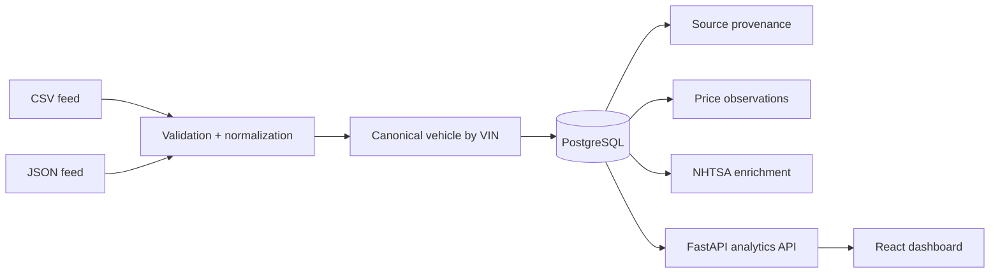

# AutoStream

AutoStream is a vehicle-data ingestion and market-intelligence portfolio project. It normalizes heterogeneous vehicle feeds into a canonical PostgreSQL model while retaining source payloads and supporting idempotent imports.

## Verified locally

- Async FastAPI, SQLAlchemy 2.x, PostgreSQL, Alembic, and Docker Compose.
- Canonical vehicles, ingestion runs/errors, source provenance, and historical price observations.
- Deterministic CSV fixtures, validation, VIN normalization, and unit-tested parsing.
- Health/readiness plus basic vehicle and ingestion-run APIs.

## Dashboard

The deliberately small React/Vite dashboard presents the real API's market overview, backend-filtered vehicle list, and VIN detail pages with price history, provenance, and NHTSA attributes. It is a demo interface, not a production frontend.

- `/` — Market Overview
- `/vehicles` — Vehicle search (filters apply only when submitted)
- `/vehicles/:vin` — Canonical vehicle, observations, provenance, and enrichment

## Multi-source ingestion

AutoStream also ingests a deterministic marketplace JSON feed with source-specific listing IDs. VIN remains the canonical identity across feeds; provenance and price observations remain independent. Marketplace conflicts do not overwrite existing non-null dealer canonical fields.

## Run

```powershell
Copy-Item .env.example .env
docker compose up --build
```

The API is available at `http://localhost:8000`; the dashboard is available at `http://localhost:5173`. Browser calls use `VITE_API_BASE_URL`, which defaults to `http://localhost:8000`. In Codespaces, rebuild after the devcontainer update, then use the forwarded ports; set `VITE_API_BASE_URL` to the forwarded API URL if the browser is not running on the Codespace host.

Then import a fixture:

```powershell
Invoke-RestMethod -Method Post 'http://localhost:8000/api/v1/ingestion/csv?fixture=dealer_feed_v1.csv'
```

## Architecture



See [architecture notes](docs/ARCHITECTURE.md). Verified behavior will be documented only after the Compose workflow is run successfully.

## Measured performance

On a deterministic 10,000-vehicle synthetic dataset in GitHub Codespaces (30 sequential localhost samples per endpoint), median VIN lookup was 2.683 ms and median market-summary latency was 29.377 ms. PostgreSQL plan evidence justified one composite latest-observation index; full methodology, plans, and limitations are in [the performance report](docs/PERFORMANCE_REPORT.md). This is not a production-scale or concurrency claim.

## Portfolio notes

The dashboard is a small portfolio interface over the real API. Screenshots remain pending rather than fabricated. Use the [demo script](docs/DEMO_SCRIPT.md) and [interview notes](docs/INTERVIEW_NOTES.md) for a concise walkthrough.

## Verification

```bash
./scripts/verify_codespaces.sh
./scripts/verify_frontend.sh
```

The first verifies the backend's deterministic intelligence workflow. The second performs a clean frontend dependency install, type-checked build, unit tests, frontend image build, and Compose HTTP shell check.
