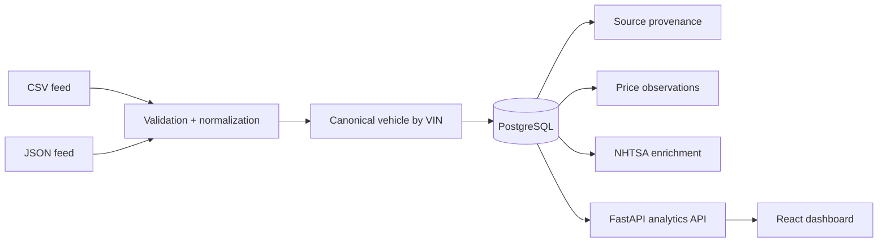

# AutoStream

AutoStream is an automotive data ingestion and data quality platform built with FastAPI, PostgreSQL, React, and an Excel Data Quality Workbench. It normalizes heterogeneous CSV and JSON feeds into canonical VIN-based vehicle records, preserves source provenance and market observations, and surfaces cross-source discrepancies for analyst investigation.

**Stack:** Python · FastAPI · PostgreSQL · SQLAlchemy · Alembic · React · TypeScript · Vite · Docker Compose · SQL · Excel · Power Query (M)

## What it enables

- **Ingest** dealer CSV and marketplace JSON feeds with VIN normalization, canonical deduplication, exact-replay idempotency, and NHTSA enrichment.
- **Reconcile** the same vehicle across sources and see exactly where attributes (make, model, trim, mileage, price) disagree.
- **Detect anomalies**: mileage regressions, attribute conflicts and drift, rejected records, coverage gaps, and ambiguous ordering.
- **Investigate** each finding in a persistent log with status, owner, and notes that survive data changes.
- **Report** quality in Excel with a scorecard, PivotTables, and conditional formatting.

## Data Quality Workbench

[`workbench/`](workbench/) is a self-contained analyst toolkit over AutoStream's data. It is isolated from the application code and ships with a synthetic sample dataset, so it runs without the database.

| Capability | What it provides |
| --- | --- |
| SQL extraction | Read-only PostgreSQL queries ([`sql/`](workbench/sql), [`extract.sh`](workbench/extract.sh)) that export vehicles, source records, ingestion runs, errors, and price observations to CSV. |
| Python validation | A reference detector ([`reference_findings.py`](workbench/reference_findings.py)) that produces the expected findings, with a pytest suite covering the detection rules and the workbook tooling. |
| Anomaly detection | Ten findings on the sample, each with a deterministic ID such as `MILEAGE_REGRESSION\|vin\|source\|record\|timestamp`, so the same issue is recognised across refreshes. |
| Cross-source reconciliation | A `Reconcile` sheet comparing each VIN's attributes side by side across sources using `XLOOKUP`. |
| Quality scorecard | A formula-driven `Scorecard` with finding counts by type, actionable totals, share of VINs affected, and data-integrity checks. |
| PivotTables | Three native PivotTables (findings by issue type and actionability, by evidence class, and investigation status). |
| Conditional formatting | Actionable-finding, status, change-flag, and check-result highlighting across findings, reconciliation, scorecard, and the log. |
| Investigation tracking | An `InvestigationLog` table keyed by `finding_id` with a status dropdown, notes, and a change flag (`OK`, `DISAPPEARED`, `EVIDENCE CHANGED`) that shows when a logged finding changes. |
| Power Query transformations | Twenty M scripts in [`queries/`](workbench/queries) (source parsing, the finding detectors, checks, and latest-observation logic), plus six self-contained bundles in [`queries/bundled/`](workbench/queries/bundled) that read the data folder from the workbook's `Config` sheet. |

Open [`AutoStream_DQ_Workbench.xlsx`](workbench/AutoStream_DQ_Workbench.xlsx) (Microsoft 365 desktop Excel) and start at the `README` sheet. The workbook contains the findings from the bundled sample, and every finding is a flag that warrants investigation, not a proven defect. Guides: [workbook guide](workbench/WORKBOOK_GUIDE.md), [investigation log](workbench/INVESTIGATION_LOG.md), [Power Query connection steps](workbench/LIVE_REFRESH.md), [extract guide](workbench/EXTRACTS.md), and [expected findings](workbench/EXPECTED_FINDINGS_NOTES.md).

## Platform highlights

- Multi-source CSV and JSON ingestion with VIN normalization and canonical deduplication.
- Historical source provenance and price/mileage/location observations.
- Exact replay idempotency and deterministic cross-source conflict handling.
- NHTSA enrichment with replay-safe persistence.
- PostgreSQL-backed market summary and vehicle market snapshots.
- React/TypeScript dashboard backed by the real API.
- Docker Compose and GitHub Codespaces reproducibility.
- Backend integration tests and frontend build/component tests.
- Synthetic-scale PostgreSQL performance measurements with `EXPLAIN ANALYZE`.

## Dashboard

The deliberately small React/Vite dashboard presents the real API's market overview, backend-filtered vehicle list, and VIN detail pages with price history, provenance, and NHTSA attributes. It is a demo interface, not a production frontend.

- `/` — Market Overview
- `/vehicles` — Vehicle search (filters apply only when submitted)
- `/vehicles/:vin` — Canonical vehicle, observations, provenance, and enrichment

## Multi-source ingestion

AutoStream also ingests a deterministic marketplace JSON feed with source-specific listing IDs. VIN remains the canonical identity across feeds; provenance and price observations remain independent. Marketplace conflicts do not overwrite existing non-null dealer canonical fields.

## Run

```powershell
Copy-Item .env.example .env
docker compose up --build
```

The API is available at `http://localhost:8000`; the dashboard is available at `http://localhost:5173`. Browser calls use `VITE_API_BASE_URL`, which defaults to `http://localhost:8000`. In Codespaces, rebuild after the devcontainer update, then use the forwarded ports; set `VITE_API_BASE_URL` to the forwarded API URL if the browser is not running on the Codespace host.

Then import a fixture:

```powershell
Invoke-RestMethod -Method Post 'http://localhost:8000/api/v1/ingestion/csv?fixture=dealer_feed_v1.csv'
```

## Architecture



See [architecture notes](docs/ARCHITECTURE.md), the [verification report](docs/VERIFICATION_REPORT.md), and the [performance report](docs/PERFORMANCE_REPORT.md) for implementation and measurement details.

## Measured performance

On a deterministic 10,000-vehicle synthetic dataset in GitHub Codespaces (30 sequential localhost samples per endpoint), median VIN lookup was 2.683 ms and median market-summary latency was 29.377 ms. PostgreSQL plan evidence justified one composite latest-observation index; full methodology, plans, and limitations are in [the performance report](docs/PERFORMANCE_REPORT.md). This is not a production-scale or concurrency claim.

## Portfolio notes

The dashboard is a small portfolio interface over the real API. Use the [demo script](docs/DEMO_SCRIPT.md) and [interview notes](docs/INTERVIEW_NOTES.md) for a concise walkthrough.

## Verification

```bash
./scripts/verify_codespaces.sh
./scripts/verify_frontend.sh
./scripts/verify_performance.sh
python -m pytest workbench    # workbench detector and tooling tests
```

These verify the deterministic backend workflow, the frontend build/test/Compose workflow, and opt-in synthetic PostgreSQL benchmark generation and query-plan capture.
