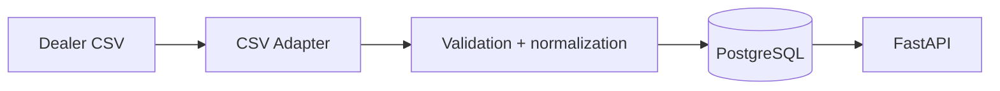

# AutoStream

AutoStream is a vehicle-data ingestion and market-intelligence portfolio project. It normalizes heterogeneous vehicle feeds into a canonical PostgreSQL model while retaining source payloads and supporting idempotent imports.

## Verified locally

- Async FastAPI, SQLAlchemy 2.x, PostgreSQL, Alembic, and Docker Compose.
- Canonical vehicles, ingestion runs/errors, source provenance, and historical price observations.
- Deterministic CSV fixtures, validation, VIN normalization, and unit-tested parsing.
- Health/readiness plus basic vehicle and ingestion-run APIs.

## Planned / not yet verified

- PostgreSQL/Compose end-to-end verification is provided by `scripts/verify_codespaces.sh` but has not run in this local environment because Docker is unavailable.
- Exact-replay and incremental semantics are covered by a PostgreSQL-only integration test, enabled with `RUN_POSTGRES_INTEGRATION=1`.
- JSON/NHTSA adapters, caching, market analytics, load testing, and a frontend are intentionally deferred.

## Run

```powershell
Copy-Item .env.example .env
docker compose up --build
```

Then import a fixture:

```powershell
Invoke-RestMethod -Method Post 'http://localhost:8000/api/v1/ingestion/csv?fixture=dealer_feed_v1.csv'
```

## Architecture



See [architecture notes](docs/ARCHITECTURE.md). Verified behavior will be documented only after the Compose workflow is run successfully.
