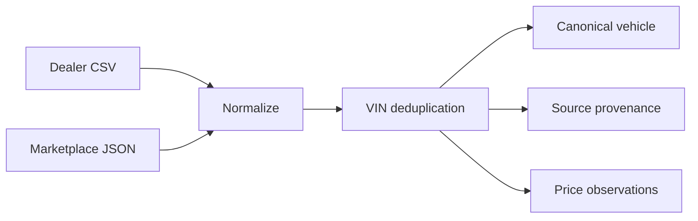

# Architecture

PostgreSQL is authoritative. `vehicles` holds one canonical record per VIN, while `vehicle_source_records` preserves every accepted source payload and `vehicle_price_observations` keeps price history rather than overwriting it.

The importers identify exact replays using a deterministic SHA-256 hash plus the source name and source record ID. Canonical vehicles are upserted by VIN with PostgreSQL `ON CONFLICT`, allowing one vehicle to be represented by multiple sources.

Dealer CSV remains authoritative for established non-null canonical fields; marketplace data fills only canonical nulls. Kafka is intentionally absent: direct bounded database transactions keep the implementation reproducible and easy to inspect.

## Multi-source identity and conflicts

VIN is the cross-source canonical identity. A source record is identified by `source_name + source_record_id + payload_hash`, so one VIN can retain independent dealer and marketplace provenance. Price, mileage, location, and timestamp are observations rather than canonical vehicle fields.

This means canonical identity and provenance deliberately have different cardinality: one row per VIN in `vehicles`, but one historical row per source-record payload version in `vehicle_source_records`. An exact replay adds neither provenance nor observations; a changed dealer payload creates a new dealer provenance version; a marketplace listing creates independent marketplace provenance.

Dealer CSV updates may update canonical descriptive fields for the same source. A later marketplace record only fills canonical nulls; it never overwrites a non-null dealer value. Conflicting raw values remain in provenance.

Indexes support VIN lookup, make/model/year filtering, source-run review, and price-observation queries. Measured `EXPLAIN ANALYZE` evidence also justified the composite latest-observation index; see the [performance report](PERFORMANCE_REPORT.md).
