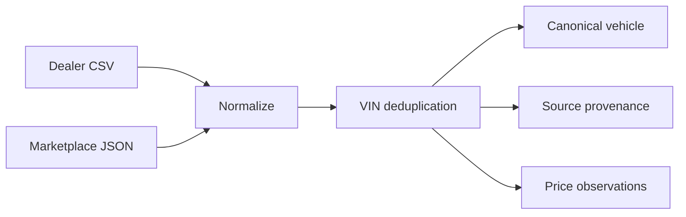

# Architecture

PostgreSQL is authoritative. `vehicles` holds one canonical record per VIN, while `vehicle_source_records` preserves every accepted source payload and `vehicle_price_observations` keeps price history rather than overwriting it.

The CSV importer identifies exact replays using a deterministic SHA-256 hash plus the source name and source record ID. Canonical vehicles are upserted by VIN with PostgreSQL `ON CONFLICT`, which allows the same vehicle to be represented by more than one source in later stages.

The initial CSV adapter retains the latest accepted field values for a VIN. A later stage will add explicit source-priority rules for heterogeneous sources. Kafka is intentionally absent: direct bounded database transactions keep the first implementation reproducible and easy to inspect.

## Multi-source identity and conflicts

VIN is the cross-source canonical identity. A source record is identified by `source_name + source_record_id + payload_hash`, so one VIN can retain independent dealer and marketplace provenance. Price, mileage, location, and timestamp are observations rather than canonical vehicle fields.

Dealer CSV updates may update canonical descriptive fields for the same source. A later marketplace record only fills canonical nulls; it never overwrites a non-null dealer value. Conflicting raw values remain in provenance.

Indexes support VIN lookup, make/model/year filtering, source-run review, and price-observation queries. Query plans should be measured with `EXPLAIN ANALYZE` against representative data before performance claims are made.
